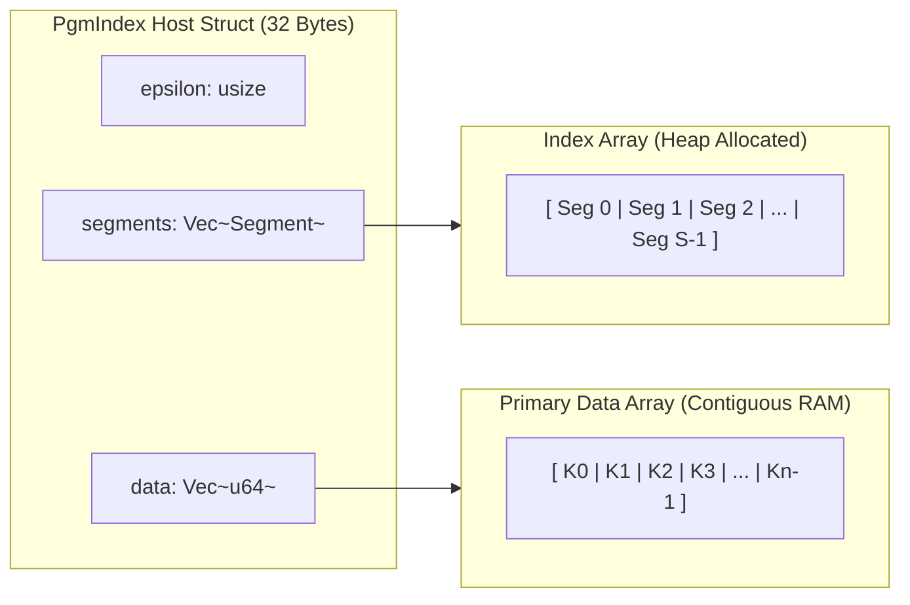
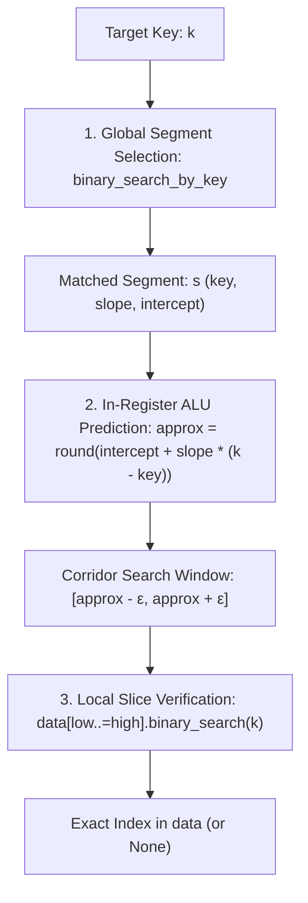
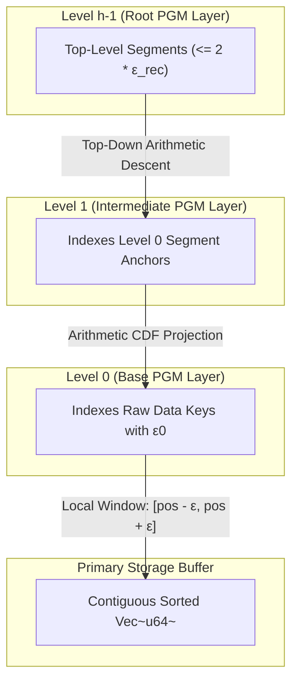

# Code Architecture & Memory Layout Guide

This document provides an architectural walkthrough of the `learned_index_lab` Rust implementation, detailing internal data structures, CPU cache alignment, arithmetic search mechanics, and microarchitectural engineering trade-offs.

---

## 1. Core Data Structures & Memory Alignment

### `Segment` Layout & 64-Byte Cache Line Density

In `learned_index_lab`, an index segment is defined as:

```rust
#[derive(Debug, Clone, Copy, PartialEq)]
pub struct Segment {
    pub key: u64,       // 8 bytes (offset 0)
    pub slope: f64,     // 8 bytes (offset 8)
    pub intercept: f64, // 8 bytes (offset 16)
}
```

* **Size of `Segment`**: 24 bytes of active payload.
* **Alignment**: 8-byte aligned (`align_of::<Segment>() == 8`).
* **Cache packing**: In standard x86_64 / ARM64 architectures with 64-byte L1/L2 cache lines:
  * Two contiguous `Segment` structs occupy **48 bytes** ($2 \times 24\text{ B}$), leaving 16 bytes for the start of a third segment.
  * Over sequential traversals, fetching a single 64-byte cache line brings **2.66 segments** directly into L1 cache without pointer chasing.

| Cache Line Slice | Struct Payload | Field Breakdown | Byte Range |
| :--- | :--- | :--- | :--- |
| **Segment 0** | 24 bytes | `key` (8B) + `slope` (8B) + `intercept` (8B) | Bytes 0–23 |
| **Segment 1** | 24 bytes | `key` (8B) + `slope` (8B) + `intercept` (8B) | Bytes 24–47 |
| **Segment 2 (Partial)** | 16 bytes | `key` (8B) + `slope` (8B) | Bytes 48–63 |

### Contiguous Data Buffer Locality

While `std::collections::BTreeMap` organizes data in heap-allocated multi-key nodes (holding up to 11 elements per node in Rust's standard library to exploit intra-node cache locality), navigating deeper levels still requires pointer dereferences between heap allocations. 

In contrast, `PgmIndex` and `MultilevelPgmIndex` decouple the index from the data:
1. `segments: Vec<Segment>`: Compact array containing only linear segment parameters.
2. `data: Vec<u64>`: Continuous sorted raw data buffer.



---

## 2. Search Mechanics: Two-Tier Arithmetic Lookup

Looking up a key $k$ in `PgmIndex` follows a two-stage process:



### Step 1: Global Segment Resolution ($O(\log S)$)
* `binary_search_by_key(&target, |s| s.key)` searches over $S$ segments.
* **Distribution Sensitivity**:
  * For smooth or moderately clustered distributions, $S \ll N$ (e.g. 93 segments / $3.1\text{ KB}$ on sequential data, or 1,416 segments / $48.1\text{ KB}$ on uniform random), allowing the entire segment table to fit comfortably inside CPU L1/L2 cache.
  * On highly irregular or heavy-tailed Pareto distributions (e.g. SOSD Books), the number of segments can reach 55,000+ ($1.50\text{ MB}$), exceeding L2 cache capacity and requiring multiple cache line fetches during the segment binary search.

### Step 2: Arithmetic CDF Projection (ALU Operation)
* Once the responsible segment $s$ is loaded:
  $$\Delta x = k - s.\text{key}$$
  $$\text{pos}_{\text{approx}} = \text{round}(s.\text{intercept} + s.\text{slope} \times \Delta x)$$
* This computation requires **1 integer subtraction**, **1 floating-point multiply-add (FMA)**, and **1 round-to-integer conversion**. Modern x86_64 CPUs execute this in $\sim 4\text{ to }6$ CPU cycles entirely inside scalar registers.

### Step 3: Bounded Local Verification ($O(\log \epsilon)$)
* The mathematical guarantee of streaming PLA ensures:
  $$\text{pos}_{\text{actual}} \in [\text{pos}_{\text{approx}} - \epsilon, \text{pos}_{\text{approx}} + \epsilon]$$
* For $\epsilon = 16$, the verification window spans at most 33 elements ($2\epsilon + 1$).
* Contiguous memory layout guarantees that these 33 elements reside across at most 4 cache lines ($264\text{ bytes}$), minimizing TLB misses and DRAM page activation latency.

---

## 3. Hierarchical Multilevel Indexing (`MultilevelPgmIndex`)

When $N > 10^7$ or under large-scale workloads where segment arrays exceed L3 cache capacities, `MultilevelPgmIndex` recursively constructs upper PGM layers over segment start keys:



* **Lookup Complexity**: $O(h \cdot \log \epsilon_{\text{rec}} + \log \epsilon_0)$, where $h \approx \log_{2\epsilon} S$.
* **Trade-off at Scale**: For $N = 10^6$, single-level `PgmIndex` is faster because the flat segment array fits in L2/L3 cache, avoiding the extra arithmetic and memory hops of multi-level descent. The hierarchical design is specifically intended for datasets exceeding tens of millions of keys.

---

## 4. Engineering Trade-offs: Linear Segments vs. Alternative Models

| Design Dimension | Streaming Linear PLA (This Lab) | High-Order Polynomials / Splines | Deep Neural Networks (MLP / RBF) |
| :--- | :--- | :--- | :--- |
| **Error Guarantees** | **Deterministic ± ε worst-case** | Hard to bound strictly | No worst-case bounds |
| **Build Complexity** | **$O(N)$ single streaming pass** | $O(N)$ to $O(N^2)$ matrix solve | $O(\text{epochs} \cdot N)$ gradient descent |
| **ALU Execution** | **1 FMA instruction ($\sim 4$ cycles)** | Multiple multiplies + division | Matrix GEMM / activation vector calls |
| **Hardware Fit** | Standard scalar registers | SIMD / AVX-512 register pressure | GPU / NPU accelerator required |
| **Index Size** | 24 bytes per segment | 48–96 bytes per spline node | Megabytes of weight matrices |
| **Branch Predictor** | 1 branchless local scan | Multiple branch checks | Model evaluation branching |

### Rationale for Linear PLA
1. **Memory Wall vs. ALU Overhead**: DRAM latency ($\sim 50\text{–}80\text{ ns}$) dominates search performance. Higher-order curves or neural networks do not reduce memory reads compared to a narrow $\epsilon = 16$ window, but dramatically increase register pressure and instruction latencies.
2. **Deterministic Guarantees**: A production database index must guarantee bounds. Streaming PLA strictly enforces that the key is within the predicted corridor without falling back to expensive unconstrained scans.
3. **Distribution Caveat**: While linear PLA excels when CDFs are piecewise regular, it remains vulnerable to distributions with extreme step-function variance (such as heavy-tailed book ISBNs), where classical tree structures like `BTreeMap` or branchless structures like `Eytzinger` provide superior lookups.
