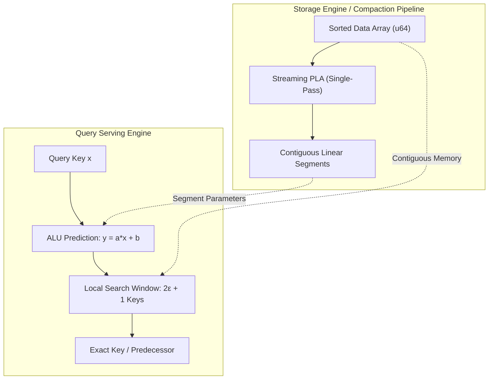

# Integration Cookbook: Practical Recipes for Production

This directory contains self-contained, production-tested integration patterns and recipes for embedding `learned_index_lab` (`PgmIndex`, `MultilevelPgmIndex`, and `EytzingerSearch`) into real-world storage engines, embedded databases, and analytical pipelines.

---

## Architectural Invariants

All learned index structures in this lab adhere to four foundational constraints:

1. **Pre-Sorted Input**: Vectors passed to constructors must be sorted in non-decreasing order (`data[i] <= data[i + 1]`).
2. **Deterministic Error Bounds**: Every key's predicted position is strictly bounded by $\pm \varepsilon$ around the true index.
3. **Zero Pointer Indirection**: Segments and data arrays are contiguous memory buffers with zero runtime heap allocations during queries.
4. **Thread-Safe Read Concurrency**: All index structures implement `Send` and `Sync`, allowing multi-threaded read sharing via `Arc`.

---

## Recipe Directory

| Recipe | Target Topic | Primary APIs & Patterns |
| :--- | :--- | :--- |
| **[1. Point & Range Queries](point_and_range_queries.md)** | Exact matches, predecessors, and range scans | `find`, `lower_bound`, `range`, `build` |
| **[2. Concurrent Read Scaling](concurrent_reads.md)** | Multi-core read parallelism without lock contention | `Arc<PgmIndex>`, `std::thread`, thread pools |
| **[3. LSM SSTable Double-Buffering](lsm_sstable_double_buffering.md)** | Non-blocking compaction lifecycle in LSM engines | `merge_sorted_batch`, `RwLock<Arc<PgmIndex>>` |
| **[4. Columnar Block Zone Maps](columnar_block_zone_maps.md)** | Sparse indexing for Parquet / ClickHouse blocks | Block boundaries, row-group pruning |
| **[5. Operational Tuning & Monitoring](operational_tuning_and_monitoring.md)** | Production sizing, epsilon tuning, and health checks | Cache line sizing, $N/S$ ratio monitoring |
