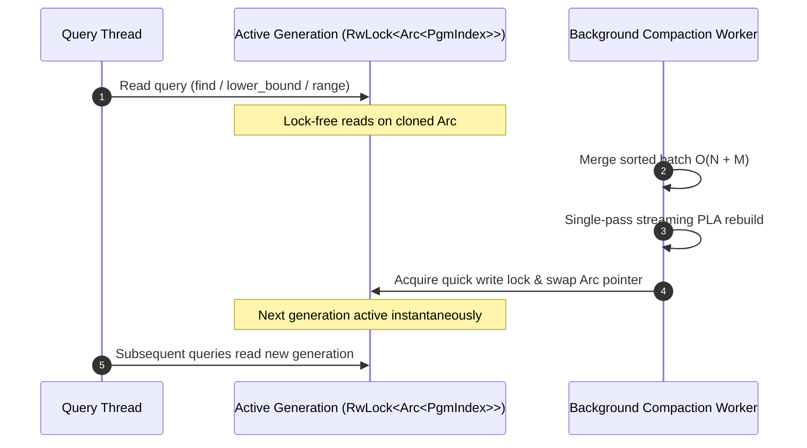

# Recipe 3: LSM SSTable Double-Buffering & Compaction Lifecycle

In Log-Structured Merge-tree (LSM) architectures (such as RocksDB, ScyllaDB, and LevelDB), immutable SSTables are flushed to storage and periodically compacted in the background.

This recipe demonstrates the **double-buffering compaction pattern**: readers continue querying the active SSTable while a background worker merges an incoming batch and atomically swaps in the new index generation.

---

## Compaction Lifecycle Architecture



---

## Complete Implementation: `LsmSstableEngine`

```rust
use learned_index_lab::PgmIndex;
use std::sync::{Arc, RwLock};

pub struct LsmSstableEngine {
    /// Active generation wrapped in an RwLock for instantaneous atomic pointer swap
    active_index: RwLock<Arc<PgmIndex>>,
    epsilon: usize,
}

impl LsmSstableEngine {
    /// Initializes an SSTable with base sorted data
    pub fn new(initial_sorted_keys: Vec<u64>, epsilon: usize) -> Self {
        let index = Arc::new(PgmIndex::build(initial_sorted_keys, epsilon));
        Self {
            active_index: RwLock::new(index),
            epsilon,
        }
    }

    /// Read query: clones Arc pointer under a brief read lock.
    /// Traversal and ALU evaluation occur completely lock-free.
    pub fn get(&self, key: u64) -> Option<usize> {
        let generation = {
            let guard = self.active_index.read().expect("Lock poisoned");
            Arc::clone(&*guard)
        };

        generation.find(key)
    }

    /// Range scan: returns a contiguous slice from the active generation snapshot
    pub fn scan(&self, start_key: u64, end_key: u64) -> Vec<u64> {
        let generation = {
            let guard = self.active_index.read().expect("Lock poisoned");
            Arc::clone(&*guard)
        };

        generation.range(start_key, end_key).to_vec()
    }

    /// Background compaction worker: merges incoming sorted batch and swaps pointer.
    pub fn compact_and_rebuild(&self, sorted_batch: &[u64]) {
        // Step 1: Snapshot active generation
        let current_generation = {
            let guard = self.active_index.read().expect("Lock poisoned");
            Arc::clone(&*guard)
        };

        // Step 2: Perform heavy O(N + M) 2-way merge and PLA construction OUTSIDE locks
        let new_generation = current_generation.merge_sorted_batch(sorted_batch);
        let new_arc = Arc::new(new_generation);

        // Step 3: Instantaneous pointer swap under exclusive write lock
        {
            let mut guard = self.active_index.write().expect("Lock poisoned");
            *guard = new_arc;
        }
    }
}
```

---

## Operational Advantages

1. **Zero Reader Downtime**: Active lookups are never blocked by the CPU-intensive 2-way merge or segment construction.
2. **Deterministic Memory Footprint**: The previous generation is freed automatically as soon as existing readers drop their cloned `Arc` references.
3. **Throughput**: Single-pass PLA constructs segments at $> 10\text{ M keys/second}$, minimizing the compaction window.
