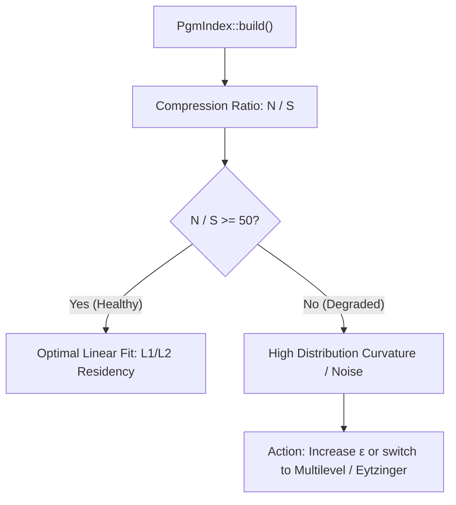

# Recipe 5: Operational Tuning, Monitoring & Production Checklist

This recipe provides concrete rules for tuning $\varepsilon$ against hardware cache lines, monitoring segment degradation in production, and selecting the optimal index architecture.

---

## 1. Hardware Cache-Line Alignment for $\varepsilon$

On x86_64 and ARM64 architectures, CPU cache lines are 64 bytes wide (storing exactly eight 64-bit `u64` keys).

The local search window size is $2\varepsilon + 1$ keys. Choosing $\varepsilon$ as a multiple of 8 aligns the search window to physical cache lines:

| $\varepsilon$ | Local Search Window ($2\varepsilon + 1$) | Cache Lines (64-byte) | Hardware Cache Tier | Best For |
| :---: | :---: | :---: | :---: | :--- |
| **8** | 17 keys (136 bytes) | ~2 cache lines | L1 Data Cache | Low-latency point lookups |
| **16** | 33 keys (264 bytes) | ~4 cache lines | L1 / L2 Cache | General-purpose default |
| **32** | 65 keys (520 bytes) | ~8 cache lines | L2 Cache | High-compression datasets |
| **64** | 129 keys (1032 bytes) | ~16 cache lines | L2 / L3 Cache | Ultra-low RAM footprint |

---

## 2. Key Metrics & Alerting Thresholds

When operating learned indexes in production storage layers, track these runtime metrics:

### Health Metrics Reference

| Metric | Calculation | Healthy Range | Degraded Signal | Recommended Action |
| :--- | :--- | :--- | :--- | :--- |
| **Compression Ratio** | `N/S` (keys per segment) | $> 100\times$ | $< 50\times$ | Increase $\varepsilon$ or evaluate key distribution skew |
| **Index Metadata Size** | `pgm.metadata_bytes()` | $< 1\%$ of raw data | $> 5\%$ of raw data | Switch to `MultilevelPgmIndex` |
| **Lookup Latency** | Mean point lookup time | $100 - 150\text{ ns}$ | $> 300\text{ ns}$ | Segments overflowing L3 cache; add hierarchical level |

---

## 3. Production Deployment Checklist

Before deploying learned index pipelines to production, verify each invariant:

- [ ] **Input Sortedness Guarantee**: Data buffer is validated with `slice.windows(2).all(|w| w[0] <= w[1])` prior to index construction.
- [ ] **Zero-Drop Compaction**: In LSM compactions, 2-way merges verify that total key count matches `initial_len + batch_len`.
- [ ] **Thread-Safe Architecture**: Shared query indexes are wrapped in `Arc` without surrounding mutexes on query hot paths.
- [ ] **Duplicate Key Plateau Bounding**: Datasets with high frequencies of identical keys are protected by the $\Delta x = 0$ absorption mechanics.
- [ ] **Memory Ceiling Verification**: Ensure auxiliary buffer allocation during double-buffered compaction does not exceed host RAM capacity.
